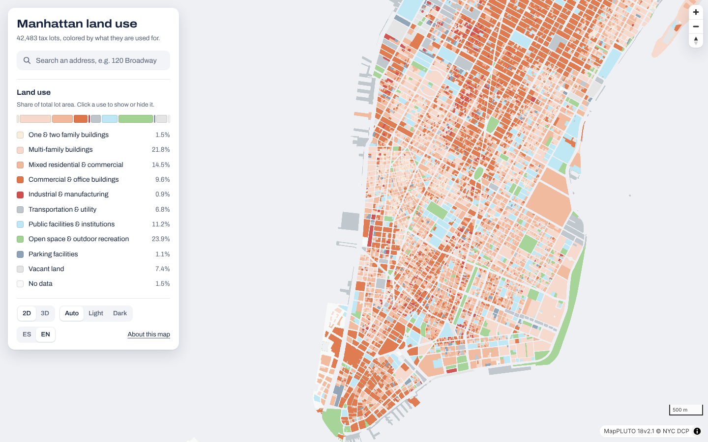
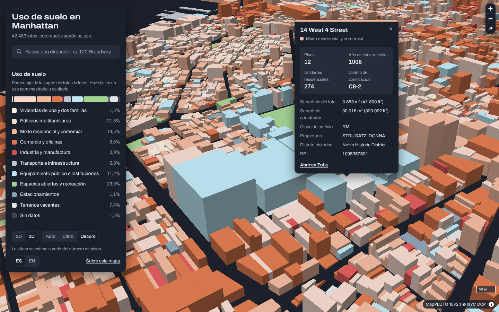
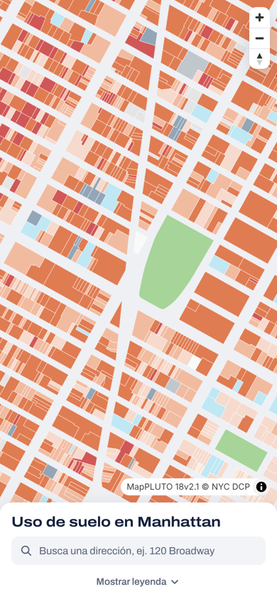

# Manhattan land use: Mapping Urban Data, rebuilt in 2026

An interactive map of land use for every one of Manhattan's 42,483 tax lots. You can search an address, filter by use, open any lot's details and switch to a 3D view where height comes from the number of floors.

**Live map:** https://sebastianmoya.github.io/mapping-urban-data/



This is my rebuild of the final project from [Morphocode's *Mapping Urban Data*](https://morphocode.com/) course (2018). The original used Mapbox GL JS v0.48, a Mapbox Studio style and a tileset hosted on Mapbox, all behind an access token. This version does the same job with open-source tools and no accounts or API keys. Everything is served as static files from GitHub Pages.

## What it does

| | |
|---|---|
| **Land-use map** | Every lot colored with the course palette (11 categories plus "no data"). |
| **Legend you can filter** | Click a use to show or hide it. The bar above the legend shows each use's share of total lot area. |
| **Lot card** | Click a lot to see its address, use, floors, year built, residential units, zoning, lot and floor area (m² and ft²), building class, owner, historic district or landmark status, BBL, and a link to the lot in NYC's [ZoLa](https://zola.planning.nyc.gov/). |
| **3D view** | Extrudes lots by `NumFloors × 3.5 m`. |
| **Address search** | Autocomplete from NYC Planning's [GeoSearch](https://labs-geosearch-docs.netlify.app/), limited to Manhattan. Picking a result flies to the lot and opens its card. |
| **ES / EN** | Spanish and English UI. Detected from the browser and remembered. |
| **Light / dark** | Follows the system theme or a manual choice. The basemap changes with it. |
| **Responsive** | The panel becomes a bottom sheet on phones. |
| **Shareable views** | The URL hash stores zoom, position, bearing and pitch. |

<p>
  
  
</p>

## 2018 vs 2026

| | Course (2018) | This version (2026) |
|---|---|---|
| Map library | Mapbox GL JS v0.48 | [MapLibre GL JS](https://maplibre.org/) v6 (BSD-3) |
| Lot tiles | Tileset uploaded to Mapbox Studio | One [PMTiles](https://docs.protomaps.com/pmtiles/) file (10.5 MB) built with [tippecanoe](https://github.com/felt/tippecanoe), served from GitHub Pages with HTTP range requests |
| Basemap | Custom Mapbox Studio style | [OpenFreeMap](https://openfreemap.org/) Positron and Dark Matter, no key needed |
| Access token | Required | None |
| Build and deploy | Hand-written HTML, GitHub Pages | [Vite](https://vite.dev/) plus a GitHub Actions workflow that publishes to Pages on every push |
| Interaction | Legend, popup, pointer cursor | Everything above, plus filter, 3D, search, i18n, dark mode, keyboard support and mobile layout |

## Data

- **Lots:** [MapPLUTO 18v2.1](https://www.nyc.gov/site/planning/data-maps/open-data/bytes-archive.page), NYC Department of City Planning. This is the release the course used. Only Manhattan lots are included (`BoroCode = 1`).
- **Fields used:** `BBL`, `Address`, `LandUse`, `ZoneDist1`, `BldgClass`, `OwnerName`, `NumFloors`, `YearBuilt`, `UnitsRes`, `LotArea`, `BldgArea`, `HistDist`, `Landmark`, `Block`, `Lot`.
- **Legend percentages** are each use's share of the summed `LotArea` of all Manhattan lots in MapPLUTO 18v2.1, calculated by [`scripts/landuse_stats.py`](scripts/landuse_stats.py). The results are in [`src/data/landuse-stats.json`](src/data/landuse-stats.json).
- **Heights in 3D** are estimated as `NumFloors × 3.5 m`. They are not measured building heights.
- **Overview tiles (z12–13)** carry only use, floors and BBL to keep the first load light. Clicking a lot at those zoom levels zooms in before the card opens.

MapPLUTO 18v2.1 is from 2018. To map current conditions, run the pipeline below on a newer MapPLUTO release.

## Run it locally

```bash
npm install
npm run dev        # http://localhost:5173/mapping-urban-data/
npm run build      # outputs static files to dist/
```

## Rebuild the tiles

Requirements: Python 3 with `pyogrio`, `pandas` and `geopandas`, plus `tippecanoe` and `tile-join`.

```bash
# 1. Download MapPLUTO (shapefile) from NYC Planning and unzip it into data/raw/
# 2. Build:
./scripts/build_tiles.sh data/raw/MapPLUTO.shp
```

The script extracts Manhattan, writes the legend stats and builds `public/data/mn_lots.pmtiles`.

## Deploy

The workflow in `.github/workflows/deploy.yml` builds the site and publishes it to GitHub Pages on every push to `main`. In the repository go to **Settings → Pages** and set **Source** to **GitHub Actions**.

## Project structure

```
index.html              panel, legend, search, dialog
src/main.js             map setup, interaction, state
src/layers.js           palette and MapLibre layers (2D, 3D, outlines, highlight)
src/popup.js            lot card
src/geocoder.js         NYC GeoSearch autocomplete
src/i18n.js             Spanish and English strings
src/style.css           UI styles, light and dark
public/data/            mn_lots.pmtiles
scripts/                data pipeline (MapPLUTO → GeoJSON → PMTiles)
```

## Credits

- Course, palette and original project: [Morphocode](https://morphocode.com/), *Mapping Urban Data*.
- Lot data: NYC Department of City Planning, MapPLUTO 18v2.1 (NYC Open Data).
- Basemap: [OpenFreeMap](https://openfreemap.org/), © [OpenMapTiles](https://openmaptiles.org/), data © [OpenStreetMap](https://www.openstreetmap.org/copyright) contributors.
- Address search: NYC Planning Labs GeoSearch.
- Typeface: [Archivo](https://github.com/Omnibus-Type/Archivo) by Omnibus-Type (SIL Open Font License).

Code in this repository is released under the MIT License. Data and basemap keep their own licenses.

---

## En español

Mapa interactivo del uso de suelo de los 42.483 lotes de Manhattan. Es mi versión 2026 del proyecto final del curso *Mapping Urban Data* de Morphocode. El original de 2018 dependía de Mapbox (token, Studio y tileset alojado allí). Esta versión usa solo herramientas open source sin cuentas ni API keys: **MapLibre GL JS** para el mapa, **PMTiles** para los lotes en un solo archivo servido desde GitHub Pages y **OpenFreeMap** para el mapa base.

Además de lo que hacía el curso (colores por uso, leyenda, ficha del lote), suma:

- Filtro desde la leyenda.
- Vista 3D por número de pisos.
- Búsqueda de direcciones con la GeoSearch de NYC Planning.
- Interfaz en español e inglés.
- Modo oscuro.
- Diseño mobile.
- Vistas que se comparten por URL.

Los datos son MapPLUTO 18v2.1 del Departamento de Planificación de Nueva York, la misma versión del curso. Los porcentajes de la leyenda son la participación de cada uso en la superficie total de lotes. La altura 3D es una estimación de pisos × 3,5 m.
